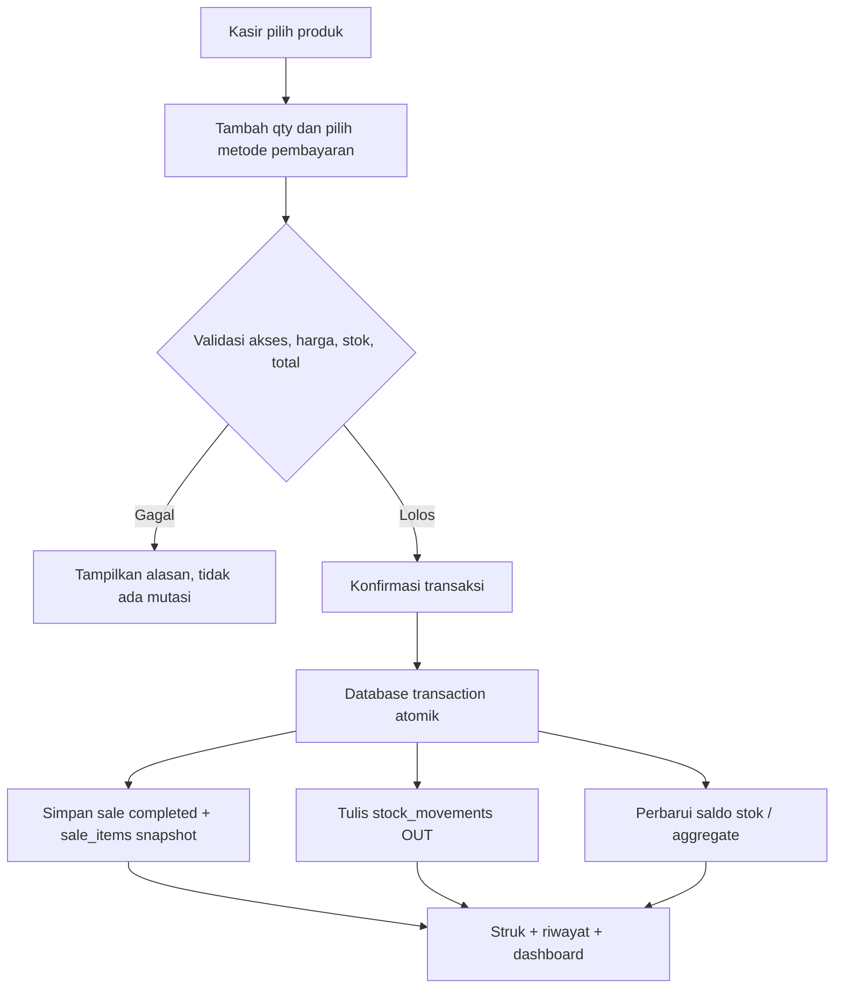
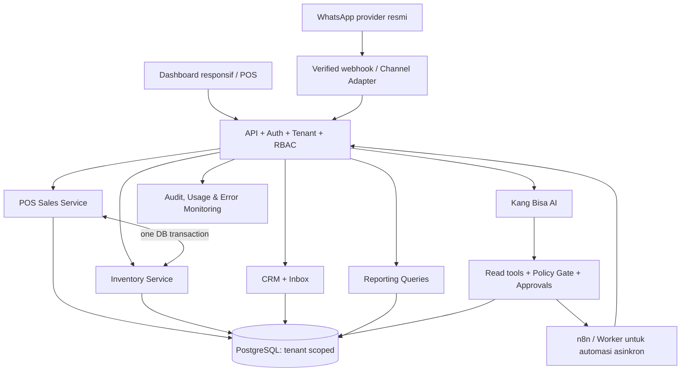

# PRODUCT REQUIREMENTS DOCUMENT (PRD)
# RENCANG AI — UMKM Business Dashboard
## CRM + POS Kasir + Stok Sederhana + Kang Bisa

**Versi:** 1.2 — Unified UMKM Operations  
**Tanggal:** 26 Oktober 2026  
**Status:** Usulan revisi scope; menunggu audit aplikasi berjalan dan persetujuan tim  
**Produk:** Rencang AI  
**Persona AI:** Kang Bisa  
**Pengguna utama:** Owner dan staf UMKM Indonesia; pilot awal Jawa Barat  
**Tagline:** *Rencang Usaha, Biar Kang Bisa yang Bantu.*  
**Dokumen induk:** `PRD_Rencang_AI_UMKM_Aligned_v1.1.md`  
**Referensi visual:** Rencang AI Visual Brand Blueprint, Kang Bisa Character Brand Blueprint, diagram Bot vs Agentic DrMetz/CSSE.

> **Keputusan v1.2:** Rencang bukan sekadar CRM dengan fitur POS tambahan di masa depan. Rencang adalah **satu dashboard operasional UMKM** yang menggabungkan **Penjualan/POS, Produk & Stok, Pelanggan/CRM, WhatsApp, Laporan, dan AI Kang Bisa**. Kompleksitas dibuat minimum; setiap modul berbagi data bisnis yang sama, terkontrol per tenant.

---

## 0. Perubahan dari PRD v1.1

| Dimensi | v1.1 | Keputusan v1.2 |
|---|---|---|
| Positioning | CRM + AI + follow-up | **CRM + POS + Stok + AI** untuk operasional UMKM |
| Pusat aktivitas | Inbox & leads | **Dashboard Usaha + Kasir**; pesan tetap penting |
| Produk/harga | FAQ dan katalog sederhana | **Master produk dengan SKU, harga, harga modal, status stok** |
| POS | Integrasi lanjutan/P2 | **POS internal dasar masuk MVP/P0** |
| Persediaan | Belum jadi modul inti | **Mutasi stok masuk/keluar dan saldo tersedia masuk P0** |
| Laporan | Leads, pesan, tugas | **Omzet, jumlah transaksi, produk laris, stok menipis, leads** |
| AI | FAQ dan tindak lanjut | **FAQ + cek data penjualan/stok berizin + rekomendasi tindakan** |
| WhatsApp | Kanal inti | Tetap fitur inti, tetapi tak boleh memblokir transaksi kasir saat koneksi WA belum siap |
| OCR nota, P&L, kampanye | P1 | Tetap P1 setelah rekonsiliasi POS dan stok stabil |
| Kompleksitas | CRM-first | **Retail/kuliner kecil single outlet first**, bukan ERP |

**Yang tetap:** identitas Rencang hijau–emas; Kang Bisa figur pria Sunda 45–50 tahun; gaya bahasa hangat; bot vs agentic; kontrol manusia; tenant terisolasi; izin/approval; posisi Rencang sebagai usaha kemitraan yang hak kepemilikan/IP-nya harus jelas. Diagram CSSE dipakai **untuk prinsip bot dan agentic**, bukan arsitektur aplikasi klinik yang harus disalin.

---

## 1. Visi & Product North Star

### Visi
**Satu tempat untuk menjalankan usaha kecil dengan lebih rapi.**

Pemilik usaha dapat menjual barang, mengecek stok, mengenali pelanggan, melanjutkan percakapan, serta melihat performa harian tanpa berpindah antara buku kas, spreadsheet, WhatsApp, dan aplikasi kasir yang tidak terhubung.

### One-liner
**Rencang AI adalah sahabat digital UMKM yang menyatukan kasir, stok, pelanggan, dan bantuan AI Kang Bisa dalam satu dashboard sederhana.**

### Nilai produk
1. **Jualan mudah:** transaksi kasir ringkas, termasuk tanpa identitas pelanggan.
2. **Stok otomatis tercatat:** penjualan mengurangi stok sesuai aturan produk dan transaksi.
3. **Pelanggan tidak hilang:** CRM dan inbox WhatsApp terkait profil pelanggan.
4. **Owner tahu kondisi usaha:** penjualan dan stok yang membutuhkan perhatian terlihat setiap hari.
5. **Kang Bisa membantu:** menjelaskan data, menyusun tindak lanjut, bukan mengarang angka atau mengeksekusi aksi berisiko tanpa izin.

### North-star metric
**Persentase hari operasional aktif dengan transaksi POS tercatat dan stok produk relevan tersinkron dengan benar** pada tenant pilot.

Metrik pendamping: pengguna aktif harian, transaksi per hari, rekonsiliasi stok, waktu input transaksi, lead tertindaklanjuti, dan retensi UMKM.

---

## 2. Siapa Pengguna Awal?

| Persona | Jobs to be done | Tampilan utama |
|---|---|---|
| **Owner UMKM** | Memantau penjualan, stok, pelanggan, dan pekerjaan | Dashboard ringkas + laporan |
| **Kasir** | Melayani pembeli dan mencatat pembayaran | POS cepat |
| **Admin/CS** | Balas WA, catat pelanggan dan pesanan | Inbox + CRM |
| **Staf gudang/toko** | Terima barang, koreksi selisih, lihat stok | Produk & stok |
| **Kang Bisa (AI)** | Membantu pencarian, ringkasan, usulan tindakan | Panel asisten sesuai hak akses |

**Pilot disarankan:** usaha produk fisik sederhana seperti toko kelontong, ritel, makanan-minuman, atau produk kecantikan nonmedis. UMKM jasa boleh memakai POS tetapi stok dapat nonaktif. **Belum** mendukung variasi manufaktur, BOM/resep produksi, serial number, pengaturan batch/kedaluwarsa penuh, dan multi-gudang di MVP.

---

## 3. Arsitektur Pengalaman: Satu Dashboard

```text
RENCANG AI
├── 1. BERANDA USAHA
│   ├── Omzet hari ini / minggu ini
│   ├── Jumlah transaksi
│   ├── Produk terlaris
│   ├── Stok menipis / habis
│   ├── Pesan pelanggan perlu dibalas
│   ├── Follow-up tertunda
│   └── Ringkasan Kang Bisa
├── 2. KASIR / POS
│   ├── Cari produk / pilih item
│   ├── Keranjang, kuantitas, diskon terbatas
│   ├── Tunai / Transfer / QRIS (pencatatan metode)
│   ├── Selesaikan transaksi
│   ├── Bukti bayar/struk sederhana
│   └── Riwayat transaksi dan pembatalan
├── 3. PRODUK & STOK
│   ├── Katalog & SKU
│   ├── Harga jual dan modal per produk
│   ├── Stok awal, masuk, keluar
│   ├── Koreksi stok dengan alasan & audit
│   ├── Batas stok minimum
│   └── Riwayat mutasi
├── 4. PELANGGAN / CRM
│   ├── Daftar & label pelanggan
│   ├── Riwayat transaksi tertaut
│   ├── Riwayat chat tertaut
│   └── Lead & tindak lanjut
├── 5. PESAN / WHATSAPP
│   ├── Inbox dan handoff admin
│   ├── Pertanyaan produk/harga/stok
│   └── Draf pesan follow-up
├── 6. LAPORAN
│   ├── Omzet dan transaksi per periode
│   ├── Produk paling laku
│   ├── Stok menipis dan mutasi
│   ├── Estimasi laba kotor (dengan syarat)
│   └── Pipeline pelanggan / follow-up
├── 7. KANG BISA
│   ├── Tanya data usaha
│   ├── Ringkasan situasi
│   ├── Saran restok dan follow-up
│   └── Antrian persetujuan tindakan
└── 8. PENGATURAN
    ├── Profil usaha, satu lokasi dan pengguna
    ├── Hak akses
    ├── Koneksi WhatsApp
    ├── Preferensi POS/stok/AI
    └── Langganan, audit, privasi
```

### Pola dashboard utama

| Elemen | Menjawab pertanyaan owner |
|---|---|
| Penjualan hari ini | "Hari ini omzet berapa?" |
| Transaksi | "Berapa pembeli yang sudah bertransaksi?" |
| Produk paling laku | "Barang apa yang paling banyak terjual?" |
| Stok menipis | "Barang apa yang harus dibeli lagi?" |
| Pelanggan perlu follow-up | "Siapa yang berpotensi beli tapi belum ditindaklanjuti?" |
| Pesan belum dibalas | "Ada chat yang terlewat?" |
| Kang Bisa | "Apa 3 prioritas hari ini?" |

**Aturan UX:** satu halaman beranda, bukan semua pekerjaan berada dalam satu layar sempit. Setiap ringkasan dapat dibuka ke modul detail; kasir hanya membutuhkan sedikit sentuhan untuk menyelesaikan pembelian.

---

## 4. Scope MVP (P0): Fitur yang Wajib Berfungsi Bersama

### P0-A. Akun Usaha & Pengguna

- Daftar satu usaha (`tenant`) dan satu lokasi default.
- Owner dapat menambahkan Admin/Kasir/Staf Stok dengan izin berbeda.
- Seluruh data operasional memiliki `tenant_id`.
- Audit perubahan harga, stok, transaksi, pengaturan, dan akses AI.

### P0-B. Produk & Katalog

- CRUD produk: SKU internal unik per tenant, nama, kategori, unit (`pcs`, `box`, `porsi`), harga jual, harga modal, status aktif, foto opsional.
- Jenis produk: **barang dilacak stok** atau **jasa/tanpa stok**.
- Satu harga jual standar; diskon transaksi hanya diizinkan sesuai role.
- Import CSV sederhana dapat menjadi pelengkap P0 jika jumlah produk pilot besar; **tidak wajib go-live**.
- Harga modal dipakai sebagai dasar estimasi laba kotor, bukan akuntansi persediaan formal.

### P0-C. Stok Sederhana — Buku Mutasi sebagai Sumber Kebenaran

- Stok awal dan stok masuk manual.
- Penjualan selesai menghasilkan **mutasi keluar** atomik.
- Pembatalan transaksi yang sudah selesai menghasilkan **mutasi pembalik**, bukan menghapus histori.
- Koreksi stok membutuhkan alasan, aktor dan waktu.
- Peringatan bila saldo `<= stok_minimum`.
- Menolak penjualan jika stok tidak cukup **secara default** untuk barang yang dilacak; owner dapat memutuskan kebijakan negatif-stok kemudian, bukan otomatis mengizinkan pada MVP.
- Satu lokasi penyimpanan; tidak ada transfer antar-gudang pada MVP.
- Tidak ada reservasi stok dari chat/lead; stok baru berkurang saat transaksi kasir dinyatakan selesai sesuai validasi yang ditetapkan.
- Nominal stok dihitung dari ledger yang konsisten; `stock_balance` cache boleh ada untuk kinerja namun harus dapat direkonsiliasi.

**Sumber kebenaran stok:** `stock_movements` + transaksi bisnis referensinya, bukan hasil tebakan AI atau catatan teks chat.

### P0-D. POS Kasir Sederhana

- Cari produk, tambah keranjang, ubah kuantitas, hapus baris.
- Pelanggan **opsional** agar transaksi walk-in cepat.
- Diskon sederhana dengan otorisasi, pajak/biaya tambahan hanya jika dikonfigurasi dan sesuai kebijakan usaha; jangan mengklaim otomatis menghitung pajak kepatuhan.
- Pembayaran: **tunai, transfer, QRIS—sebagai metode yang dicatat**. Tidak ada payment gateway otomatis pada MVP.
- Validasi jumlah pembayaran terhadap total; status `draft`, `completed`, `voided`.
- Setelah `completed`, transaksi menyimpan snapshot item: nama, SKU, harga, diskon, modal saat jual, jumlah, nominal.
- Selesaikan POS dan pengurangan stok dalam **satu transaksi database**. Jika gagal, semua dibatalkan sehingga tidak terjadi penjualan tercatat tanpa mutasi stok.
- Pencarian struk/riwayat transaksi; cetak/unduh struk dasar atau bagikan ringkasan sesuai izin pelanggan dan kanal.
- Pembatalan oleh pihak yang berizin wajib alasan, dan akan membalik mutasi stok dengan audit; alur pengembalian dana finansial masih manual.
- Penjualan tanpa koneksi internet/offline sync bukan bagian MVP.

### P0-E. CRM Pelanggan

- Nama, nomor WA bila disediakan, label, catatan singkat dan consent komunikasi.
- Riwayat transaksi POS tertaut bila pelanggan dipilih saat checkout.
- Penggabungan kontak duplikat manual; jangan mengasumsikan nomor WA teridentifikasi untuk walk-in anonim.
- Pipeline sederhana: baru → dihubungi → tertarik → penawaran → menang/kalah.
- Tugas follow-up manual, PIC dan due date.
- Penghapusan/anonymization pelanggan sesuai kebijakan privasi; transaksi bisnis tetap memiliki catatan yang perlu disimpan menurut kebijakan hukum dan audit.

### P0-F. WhatsApp dan Kang Bisa

- Koneksi WhatsApp Business Platform/penyedia resmi, webhook tervalidasi, status delivery, handoff.
- Jika integrasi kanal belum lolos verifikasi, **POS dan stok tetap dapat dipakai**; tampilkan status "WhatsApp belum terhubung".
- **Bot**: jawab jam buka, harga dari katalog, dan ketersediaan stok **saat itu** berdasarkan API read-only; jika stok tidak tersedia atau ambigu, minta admin.
- **Agentic terbatas**: identifikasi pembeli yang perlu follow-up → baca riwayat berizin → buat draf → minta approval → buat tugas / kirim hanya ketika kebijakan kanal, izin, dan level persetujuan terpenuhi.
- Tidak membuat atau menyelesaikan transaksi POS melalui pesan AI pada MVP.
- Kang Bisa boleh menjawab pertanyaan owner: omzet, produk laku, stok menipis dan follow-up berdasarkan data aplikasi, termasuk periode dan sumber perhitungan.
- Tidak boleh menyatakan transfer telah dibayar hanya dari tangkapan layar pelanggan; transaksi kasir dan verifikasi pembayaran adalah ranah manusia/layanan pembayaran yang sah.

### P0-G. Laporan Ringkas

- Omzet dari transaksi `completed` dikurangi transaksi yang dibatalkan melalui mekanisme reversal; tampilkan definisi dan rentang tanggal.
- Jumlah transaksi yang selesai.
- Top produk berdasarkan kuantitas dan nominal penjualan.
- Stok tersedia, stok rendah, riwayat perubahan.
- **Estimasi laba kotor** = penjualan bersih − estimasi HPP item terjual, jika data harga modal valid; beri label **estimasi**.
- Jangan menyebut "laba bersih" jika biaya operasional/pajak/retur belum lengkap.
- Ringkasan CRM: lead, follow-up tertunda, chat perlu admin.

### P0-H. Keamanan, Audit & Operasional

- Pembatasan role per aksi.
- Idempotency key untuk checkout dan pemrosesan webhook agar retry tidak menggandakan transaksi atau stok.
- Backup harian, log error dan biaya per tenant, alert bila selisih stok sistem.
- Staging/prod dipisahkan; semua tenant diisolasi pada data dan retrieval AI.
- Mode manual tetap tersedia jika AI down.

---

## 5. P1 / P2 — Hindari ERP Prematur

| P1 setelah MVP stabil | P2 bila kebutuhan terbukti |
|---|---|
| Pencatatan pengeluaran sederhana | Multi-outlet/multi-gudang |
| OCR foto nota → draft → verifikasi manusia | Integrasi marketplace dan POS eksternal |
| Pembelian/restok lebih rapi dengan pemasok | Resep/BOM, bahan baku dan produksi |
| Retur sederhana dengan uang/stok direkonsiliasi | Lot, batch, expiry, serial number |
| Pengingat restok dan tugas pemasok | Loyalty/poin dan promo lanjutan |
| Follow-up WA otomatis sesuai izin | Payment gateway dan rekonsiliasi bank |
| Laporan laba-rugi sederhana berdasarkan data lengkap | Modul akuntansi/pajak formal |
| Barcode scanner/label bila perangkat mendukung | Offline POS dan konflik sinkronisasi |
| Template spesifik industri | API publik/MCP/workflow builder |

**Keputusan batas produk:** Rencang tidak menyalin modul HRD, AEVIA, Klinik Sistem, rekam medis atau CSSE. API Nexora/CSSE adalah opsi integrasi terpisah dan tunduk kepada persetujuan bisnis, keamanan dan IP.

---

## 6. Alur Utama End-to-End

### 6.1 Penjualan kasir → stok → dashboard



### 6.2 Pembatalan transaksi

```text
Owner/kasir berizin memilih transaksi selesai
  → tulis alasan pembatalan
  → cek aturan dan status
  → buat reversal dalam transaksi database yang atomik
  → mutasi stok IN sesuai qty awal (untuk item stok)
  → catat status voided, actor, audit event
  → sesuaikan laporan penjualan
  → bila ada pengembalian dana, proses dan rekonsiliasi manual sesuai SOP
```

Jangan menghapus transaksi asli karena akan merusak audit dan konsistensi stok.

### 6.3 Pelanggan dari WA menjadi transaksi POS

```text
Pesan WA masuk
 → Kang Bisa jawab FAQ/katalog dari data usaha
 → admin menandai lead/pelanggan
 → pelanggan datang / memesan dan pembayaran diverifikasi oleh kasir
 → kasir memilih pelanggan pada transaksi (opsional)
 → transaksi selesai, stok berkurang
 → riwayat pembelian terlihat pada profil pelanggan
 → usulan follow-up pascapenjualan menunggu aturan izin
```

**Tidak ada pemotongan stok hanya karena pelanggan bertanya atau chat "mau pesan".**

### 6.4 Owner meminta insight Kang Bisa

```text
Owner: "Kang, jualan hari ini gimana?"
 → cek izin actor/tenant
 → query penjualan completed periode lokal tenant
 → query stok rendah dan produk terlaris
 → tampilkan angka + periode + status data
 → beri maksimal 3 saran praktis
 → tidak melakukan perubahan harga/restok secara otomatis
```

### 6.5 Stok masuk dari pemasok

```text
Staf buka Produk & Stok → Stok Masuk
 → pilih SKU + jumlah + catatan/sumber
 → verifikasi jumlah/role
 → tulis stock_movements IN
 → saldo dan peringatan restok diperbarui
 → log actor, waktu, sumber
```

---

## 7. Bot vs Agentic: Pemetaan yang Sesuai Dashboard UMKM

| Modul | Bot: satu tugas | Agentic: multi-langkah terkontrol |
|---|---|---|
| POS | Jawab total transaksi hari ini | Rangkum penjualan → identifikasi produk dominan → rekomendasikan aksi |
| Stok | "Stok sabun A berapa?" | Temukan stok rendah → bandingkan penjualan terkini → susun daftar restok → owner setujui tugas |
| CRM | Cari profil pelanggan | Seleksi prospek tertunda → susun pesan personal → approval → buat tugas follow-up |
| WhatsApp | Jawab jam buka dan harga dari katalog | Klasifikasi kebutuhan → referensi produk → serahkan ke admin jika negosiasi |
| Laporan | Tampilkan omzet terverifikasi | Gabung penjualan + stok + lead → sarankan 3 prioritas hari ini |

### Level otonomi
- **L0 Read-only:** pertanyaan dan ringkasan data berizin → MVP.
- **L1 Suggest:** tag, draft, next action dan rekomendasi → MVP.
- **L2 Approved Action:** membuat tugas atau mengirim balasan aman sesuai policy/approval → MVP terbatas.
- **L3 Scheduled automation:** follow-up dan alert restok otomatis → P1.
- **L4 Financial/stock mutation:** AI tidak boleh menyelesaikan POS, mengubah saldo stok, mengeluarkan refund, atau mengubah harga tanpa UI/izin manusia pada MVP.

---

## 8. Hak Akses

| Aksi | Owner | Admin | Kasir | Staf Stok | Kang Bisa |
|---|---|---|---|---|---|
| Lihat omzet ringkas | Ya | Jika diberi | Terbatas | Tidak default | Berizin read-only |
| Proses POS | Ya | Jika diberi | Ya | Tidak | Tidak |
| Batal POS | Ya | Jika diberi | Ajukan | Tidak | Tidak |
| Edit produk & harga | Ya | Jika diberi | Tidak default | Tidak default | Draf saja |
| Stok masuk/koreksi | Ya | Jika diberi | Tidak | Stok masuk, koreksi terbatas | Usulan saja |
| CRM & inbox | Ya | Ya | Terbatas | Tidak default | Berizin |
| Kirim WA outbound | Persetujuan | Jika diizinkan | Tidak default | Tidak | Draf / aksi approved |
| Ekspor seluruh data | Kontrol tambahan | Jika diberi | Tidak | Tidak | Tidak |
| Atur role/billing | Ya | Tidak default | Tidak | Tidak | Tidak |

**Catatan:** matriks di atas merupakan default produk; hak akhir berbasis RBAC granular dan kebijakan setiap tenant.

---

## 9. Arsitektur Teknis MVP

**Prinsip:** modular monolith yang kecil, bukan microservices besar atau mini-ERP.



**Critical invariant:**
1. `sales.completed` harus sinkron dengan `stock_movements` untuk item terlacak.
2. Tidak ada mutasi stok ganda saat permintaan checkout diulang.
3. Semua query, termasuk AI, dibatasi tenant dan role.
4. Koneksi WhatsApp dan AI gagal **tidak boleh** merusak transaksi POS.
5. Harga dan HPP untuk laporan historis memakai snapshot transaksi, bukan angka katalog saat ini.

### Stack rekomendasi (mengikuti kompetensi tim)
- Frontend: React/Next.js/TypeScript atau framework eksisting.
- Backend: satu API monolith modular TypeScript atau FastAPI, pilih yang sudah berjalan.
- Database: PostgreSQL dengan constraint, row locks saat checkout, tenant isolation (RLS atau setara).
- n8n: notifikasi, pekerjaan follow-up dan sinkronisasi asinkron; bukan penulis langsung tabel stok/penjualan.
- AI: provider-agnostic, read tools terbatas, prompt persona Kang Bisa, logging biaya.
- WhatsApp: Business Platform/penyedia resmi; verifikasi webhook, delivery status, opt-in/opt-out.
- Deployment: VPS/cloud sesuai beban pilot, enkripsi, backup, pemisahan dev/staging/prod.
- Barcode, printer, QRIS device: perangkat tambahan; jangan diasumsikan tersedia pada MVP.

---

## 10. Model Data Inti

Semua tabel data operasional wajib memuat `tenant_id` dan timestamp yang relevan.

| Tabel | Kolom kunci |
|---|---|
| `tenants` | id, name, timezone, plan, status |
| `users`, `memberships` | user_id, tenant_id, role, status |
| `locations` | id, tenant_id, label (satu lokasi default di MVP) |
| `products` | id, tenant_id, sku, name, category, unit, track_stock, price, cost, min_stock, is_active |
| `stock_movements` | id, tenant_id, product_id, location_id, type, qty_signed, source_type, source_id, reason, actor_id, created_at |
| `stock_balances` | tenant_id, product_id, location_id, quantity (cache terkendali), updated_at |
| `sales` | id, tenant_id, location_id, receipt_no, customer_id?, subtotal, discount_total, total, payment_method, status, cashier_id, completed_at, voided_at |
| `sale_items` | id, sale_id, product_id, sku_snapshot, name_snapshot, qty, unit_price_snapshot, unit_cost_snapshot, discount, line_total |
| `customers` | id, tenant_id, name, phone?, consent_status |
| `conversations`, `messages` | id, tenant_id, customer_id?, channel_id, status, content_ref |
| `leads`, `tasks` | id, tenant_id, customer_id, status/stage, assignee, due_at |
| `knowledge_items` | id, tenant_id, type, content, verified_at, active |
| `proposed_actions` | id, tenant_id, action, payload, risk, approval_status |
| `audit_events` | id, tenant_id, actor, action, entity_id, outcome, created_at |
| `usage_events` | id, tenant_id, model/tool, units, estimated_cost, created_at |

### Ketentuan integritas data
- Harga jual dan modal transaksi disimpan sebagai snapshot.
- Mutasi stok bernilai signed (+ masuk / − keluar), disertai jenis referensi.
- `idempotency_key` unik per tenant/aksi untuk POS.
- `(tenant_id, sku)` unik untuk produk aktif sesuai aturan yang ditetapkan.
- Checkout dalam transaction DB dengan kunci stok/optimistic concurrency agar dua kasir tidak menjual stok unit terakhir secara bersamaan.
- Pembatalan memakai reversal berbasis transaction reference yang tidak dapat diproses dua kali.
- Transaksi historis tidak dihapus fisik oleh AI.

---

## 11. Contoh Kontrak API (Ilustratif, Belum Implementasi)

```http
GET    /api/v1/dashboard/summary?period=today
GET    /api/v1/products
POST   /api/v1/products
PATCH  /api/v1/products/{id}
GET    /api/v1/inventory/balances
GET    /api/v1/inventory/movements
POST   /api/v1/inventory/stock-in
POST   /api/v1/inventory/adjustments
POST   /api/v1/pos/sales
GET    /api/v1/pos/sales/{id}
POST   /api/v1/pos/sales/{id}/void
GET    /api/v1/customers
GET    /api/v1/customers/{id}/purchases
GET    /api/v1/conversations
POST   /api/v1/agent/query
POST   /api/v1/agent/actions/{id}/approve
POST   /api/v1/webhooks/whatsapp
```

**Contoh checkout:**

```json
{
  "idempotency_key": "pos-order-001",
  "location_id": "LOC-01",
  "customer_id": null,
  "items": [
    { "product_id": "PRD-01", "qty": 2 },
    { "product_id": "PRD-03", "qty": 1 }
  ],
  "payment": {
    "method": "cash",
    "amount_received": 100000
  }
}
```

**Penting:** client tidak memasukkan harga tepercaya; server mengambil harga terbaru yang diizinkan, menghitung total dan change, memvalidasi stok, lalu mengunci snapshot final secara atomik. Jika terjadi perubahan harga setelah kasir melihat keranjang, minta konfirmasi harga final.

---

## 12. Contoh Interaksi Kang Bisa

**Owner:** “Kang, bagaimana usaha hari ini?”  
**Kang Bisa:** “Hari ini ada 27 transaksi dengan omzet Rp1.850.000 dari transaksi yang sudah selesai. Stok 3 produk sudah di bawah batas minimum dan ada 5 pelanggan yang perlu di-follow-up. Mau saya buatkan daftar prioritasnya?”

> Angka di atas **contoh UI fiktif**, bukan data usaha nyata.

**Owner:** “Siapkan barang yang harus direstok.”  
**Kang Bisa:** “Saya buatkan daftar produk berdasarkan stok saat ini dan penjualan terbaru. Saya belum memesan barang atau mengubah stok. Silakan periksa jumlah usulannya.”

**Pembeli:** “Kang, sabun A masih ada?”  
**Kang Bisa:** “Saya cek stok yang tercatat di toko dulu, ya. Kalau informasi belum bisa dipastikan, saya sambungkan ke admin.”

---

## 13. Functional Requirements & Acceptance Criteria

| ID | P0 requirement | Acceptance criteria / bukti uji |
|---|---|---|
| FR-001 | Satu dashboard | Owner melihat transaksi, omzet, stok rendah, lead, inbox di satu beranda |
| FR-002 | POS dasar | Kasir dapat menjual >1 produk, mencatat metode bayar dan memperoleh struk |
| FR-003 | Stok otomatis | Sale completed mengurangi stok tepat 1 kali per item; uji retry |
| FR-004 | Stok habis | Penjualan item tracked ditolak bila saldo kurang; tanpa double-sell |
| FR-005 | Pembatalan | Voiding sale membalik stok satu kali dan mengoreksi laporan |
| FR-006 | Stok masuk | Staff berizin menambah stok, tercatat actor/alasan/sumber |
| FR-007 | Katalog produk | Harga dan SKU berbeda antar tenant tidak saling terbaca |
| FR-008 | CRM + transaksi | Pembelian yang menyertakan customer muncul pada histori customer |
| FR-009 | WhatsApp | Pesan masuk tertaut tenant benar; gagal WA tidak menghambat POS |
| FR-010 | FAQ Kang Bisa | Menjawab harga/stok dari API, tidak mengarang bila data kosong |
| FR-011 | Agentic approval | AI hanya membuat draf/tugas; tidak memodifikasi stok/POS secara mandiri |
| FR-012 | Laporan | Omzet sesuai penjualan valid setelah reversal, dengan periode eksplisit |
| FR-013 | Role & audit | Kasir tak bisa mengubah harga modal/stock adjustment tanpa izin |
| FR-014 | Tenant isolation | UI/API/AI tenant A tidak membaca tenant B |
| FR-015 | Ketahanan | Kegagalan agent/WA tidak menyebabkan checkout ganda/korup |
| FR-016 | Stok tracking opsional | Produk jasa terjual tanpa mutasi stok |
| FR-017 | Idempotency | Double-tap checkout menghasilkan satu sale completed |
| FR-018 | Rekonsiliasi | Saldo stok dapat dihitung ulang dari ledger dan cocok dengan cache |

---

## 14. Nonfunctional Requirements (Target Pilot, Bukan Janji SLA)

- UI utama usable di telepon 360 px dan desktop.
- Checkout POS p95 < 3 detik dalam jaringan pilot stabil, tanpa menyertakan proses pembayaran eksternal.
- Aplikasi diarahkan ke availability 99,5% setelah operasi terukur; bergantung infrastruktur.
- **Tidak ada stok negatif** akibat concurrent checkout untuk tracked items (default MVP).
- **Tidak ada penjualan ganda** akibat retry request dengan idempotency key sama.
- Backup terjadwal dan simulasi restore sebelum paid pilot.
- Transaksi dan stok tetap berfungsi saat LLM/WhatsApp mengalami outage.
- Semua query dibatasi role dan tenant; audit tindakan sensitif lengkap.
- Retensi dan perlindungan data pelanggan mengikuti kebijakan yang diverifikasi dengan penasihat hukum.

---

## 15. Kualitas Keamanan & Batas AI

1. Pisahkan data antar UMKM; jangan ada super-database yang dapat dibaca semua pelanggan.
2. Jangan memberikan kredensial mentah atau akses DB langsung kepada agent.
3. AI hanya dapat memanggil tool dengan allowlist dan parameter schema.
4. Periksa izin tenant dan pengguna di server **untuk setiap tool call**, bukan hanya di prompt.
5. Keputusan promo, refund, pembelian barang, perubahan harga, penyelesaian transaksi dan stock adjustment perlu hak manusia.
6. Pesan WhatsApp mengikuti aturan kanal resmi, persetujuan penerima, periode/template yang diizinkan dan mekanisme opt-out.
7. Harga/stok dari data operasional; AI tidak boleh mengarang jumlah.
8. Hasil chat pelanggan adalah input tidak tepercaya—tidak bisa mengubah kebijakan agent.
9. Angka laba kotor hanya estimasi bila modal belum lengkap; tidak mengklaim laba bersih.
10. Akses dukungan Rencang kepada data tenant dibatasi dan diaudit; governance kemitraan/IP terpisah.

---

## 16. Peta Monetisasi — Masih Hipotesis

| Paket | Peruntukan | Cakupan |
|---|---|---|
| **Rencang Starter** | Warung/toko mikro | POS 1 lokasi, produk & stok, laporan ringkas, akses terbatas |
| **Rencang Plus** | UMKM dengan admin/CS | Starter + CRM + WhatsApp + Kang Bisa serta approval |
| **Rencang Custom** | Workflow lebih kompleks | Integrasi/perangkat tambahan setelah penilaian biaya |

**Referensi harga yang pernah dibahas:** sekitar **Rp299.000/bulan** untuk paket awal berfitur AI. **Belum menjadi harga final versi POS**. Model dan harga harus diuji ulang berdasarkan biaya server, pesan WhatsApp resmi, model AI, jumlah pengguna, jumlah transaksi, dan support.

Jangan menjual paket “unlimited AI/WA” tanpa pemodelan biaya dan ketentuan penggunaan yang masuk akal.

---

## 17. Roadmap yang Menjaga Scope

### Fase 0 — Audit & desain integrasi (1–2 minggu, estimasi)
- Petakan fitur yang **sudah ada**: CRM, chatbot, server, database, workflow dan UI; beri status `existing / partial / new`.
- Pilih 1 bisnis ritel nyata untuk pilot.
- Tetapkan skema SKU, metode pembayaran, aturan void, harga modal, dan stok.
- Buat prototype satu dashboard + mode Kasir.

### Fase 1 — Core POS + inventory (3–5 minggu, estimasi)
- Produk, stok awal, mutasi, kasir, sale items, struk, void.
- Uji race condition, double tap, reversal, dan rekonsiliasi ledger.

### Fase 2 — Unified Dashboard + CRM/WA/AI (3–5 minggu, estimasi)
- Hubungkan penjualan ke pelanggan.
- Satukan dashboard, laporan, inbox dan Kang Bisa.
- Mulai dengan read-only AI; naikkan ke action approved sesuai kualitas.

### Fase 3 — Pilot 5–10 UMKM dan perbaikan (2–4 minggu, estimasi)
- Uji retail/kuliner nonkompleks.
- Ukur error transaksi, selisih stok, waktu checkout, kepuasan, dan kesediaan membayar.
- Prioritaskan perbaikan kritis sebelum P1.

**Estimasi tahap bukan komitmen jadwal.** Kapasitas tim, kemampuan yang sudah dibangun, serta integrasi WhatsApp dapat mengubah urutan.

---

## 18. KPI & Go-Live Gates

### KPI bisnis
- UMKM aktif mingguan.
- Rasio trial → paid, retensi 30/90 hari, MRR dan churn.
- Biaya dukungan per tenant; margin termasuk AI/WA.

### KPI operasi
- Transaksi POS tercatat per hari dan waktu rata-rata checkout.
- Akurasi rekonsiliasi stok 100% terhadap ledger untuk transaksi yang valid.
- Jumlah kasus selisih stok fisik vs sistem; audit penyebab.
- Tingkat stok menipis yang ditangani owner.
- Jumlah prospek yang di-follow-up dari dashboard.

### Gate sebelum pilot berbayar
- [ ] Checkout dan mutasi stok atomik, lolos uji concurrent sale.
- [ ] Double tap menghasilkan tepat satu transaksi.
- [ ] Sale void menghasilkan satu reversal sesuai item.
- [ ] Kasir tidak dapat mengubah harga modal atau stok tanpa izin.
- [ ] Tenant A tidak bisa melihat data tenant B, termasuk dari AI.
- [ ] WA/AI downtime tidak menghentikan kasir.
- [ ] Harga/total selalu dihitung server.
- [ ] Laporan penjualan sesuai ledger transaksi.
- [ ] Metode pembayaran pada MVP adalah **pencatatan**, bukan bukti otomatis dana diterima.
- [ ] Kang Bisa tidak mengirim pesan massal / mengubah stok tanpa otorisasi.
- [ ] Backup dan restore teruji.
- [ ] Owner pilot dapat menjalankan kasir dan lihat stok tanpa tutorial panjang.

---

## 19. UX Copy & Aturan Visual

**Brand tidak berubah:** Rencang Green `#0E4D3A`, Sunda Gold `#D4A956`, Warm Ivory `#F8F5EC`, Charcoal `#2D2D2D`, Plus Jakarta Sans, Lora sebagai aksen; simbol R daun/chat dan karakter Kang Bisa sesuai master gambar.

**Menu bahasa sehari-hari:** `Beranda`, `Kasir`, `Produk & Stok`, `Pelanggan`, `Pesan`, `Laporan`, `Kang Bisa`, `Pengaturan`.

**Perintah Kang Bisa**:
- “Kang, cek omzet hari ini.”
- “Barang mana yang hampir habis?”
- “Siapkan daftar restok.”
- “Siapa pelanggan yang perlu saya hubungi?”
- “Buat ringkasan usaha sore ini.”

**Hindari jargon teknis di UI:** agentic workflow, inventory ledger, RAG, orchestration, database transaction. Gunakan **“stok masuk”, “stok menipis”, “transaksi selesai”, “perlu persetujuan”, “pesan belum dibalas”.**

---

## 20. Open Decisions — Perlu Ditetapkan Saat Audit

1. Jenis UMKM pilot: ritel produk, kuliner sederhana atau lainnya?
2. Pencatatan pembayaran: tunai, transfer dan QRIS manual cukup untuk P0?
3. Apakah produk punya varian ukuran/warna pada MVP, atau SKU independen per varian?
4. Boleh diskon nominal/persen? Siapa yang boleh setujui?
5. Apakah stok negatif dilarang secara mutlak? Rekomendasi: ya pada pilot.
6. Struk via printer thermal langsung dibutuhkan atau PDF/print browser cukup?
7. Apakah ada data POS/CRM eksisting yang harus diimpor?
8. Aturan pembatalan transaksi dan SOP pengembalian uang oleh manusia?
9. Jumlah produk dan transaksi tipikal pilot untuk tes performa?
10. Konektor WhatsApp resmi yang benar-benar tersedia dan biaya aktual?
11. Paket Rp299 ribu dipakai untuk Plus atau Starter, mengingat tambahan beban POS?
12. Kepemilikan kode, desain, kontrak produk dan hak penggunaan bersama Nexora dituangkan di dokumen mitra mana?

---

## 21. Prinsip Penutup

> **Rencang AI = Kasir + Stok + Pelanggan + WhatsApp + Kang Bisa, dalam satu dashboard UMKM yang ringan.**
>
> **POS dan stok adalah sumber transaksi operasional. CRM adalah konteks pelanggan. Kang Bisa membaca dan membantu mengerjakan tugas melalui izin yang jelas. Owner tetap memegang keputusan.**

MVP berhasil bukan ketika fitur terlihat banyak, tetapi ketika **setiap penjualan tercatat, stok terjaga, pelanggan mudah ditindaklanjuti, dan owner cepat memahami kondisi usaha**.
